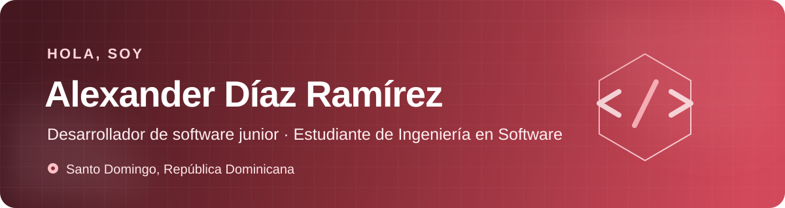

  

  
  

## Sobre mí

Soy **desarrollador de software junior** y estudiante de término de **Ingeniería en Software** en la Universidad Federico Henríquez y Carvajal (UFHEC), en Santo Domingo, República Dominicana.

- Actualmente trabajo como **Desarrollador Junior en GoGo Delivery RD**, colaborando de forma remota con el equipo en el desarrollo de su aplicación de pedidos, bajo contrato por proyecto.
- Desarrollo aplicaciones con **C#, ASP.NET Core MVC y SQL Server**.
- He trabajado con arquitectura por capas, operaciones CRUD, Entity Framework y APIs.
- También desarrollo aplicaciones móviles con **.NET MAUI**; tengo conocimientos básicos de Flutter y Docker.
- Me interesa integrar modelos de lenguaje locales con **Ollama** y seguir creciendo en nube y despliegue.
- Busco oportunidades como desarrollador junior .NET y proyectos remotos con horarios flexibles.

> **Actualmente:** participando en el desarrollo de **GoGo Delivery RD**, una aplicación de pedidos construida en equipo bajo un contrato por proyecto.

## Tecnologías

### Backend y datos

### Mobile, frontend e IA

### Herramientas

## Proyectos destacados

<table>
  <tr>
    <td width="50%" valign="top">
      <h3>SmartFitAssistant</h3>
      
Versión mejorada de un asistente de entrenamiento físico que utiliza un modelo local mediante Ollama. Incluye perfiles básicos de usuario, historial de conversación y distintas técnicas de prompting.

      
<strong>Stack:</strong> C#, ASP.NET Core MVC, Ollama y Microsoft.Extensions.AI.

      <a href="https://github.com/AlexanderDiazRz/SmartFitAssistant-">Ver repositorio →</a>
    </td>
    <td width="50%" valign="top">
      <h3>TuAsistenteGYM</h3>
      
Primera versión del asistente de gimnasio. Este proyecto muestra el punto de partida y la evolución técnica que luego continuó en SmartFitAssistant.

      
<strong>Stack:</strong> C#, ASP.NET Core MVC, Ollama y técnicas de prompt engineering.

      <a href="https://github.com/AlexanderDiazRz/TuAsistenteGYM">Ver repositorio →</a>
    </td>
  </tr>
</table>

## Experiencia

- **Desarrollador Junior — GoGo Delivery RD (actual):** colaboración remota con el equipo en el desarrollo de una aplicación de pedidos, bajo contrato por proyecto.
- **Desarrollador Freelance:** sistemas web a la medida con ASP.NET Core MVC, arquitectura por capas, CRUD, SQL Server y trato directo con clientes.
- **Pasante — Biblioteca Universitaria UFHEC:** gestión documental, clasificación de recursos y atención al usuario.

## Formación

- **Ingeniería en Software** — UFHEC, estudiante de término.
- **Programando en C#: de principiante a profesional** — Udemy.
- **Inglés Intensivo 5** — ITLA.
- Cursos de **Git** y fundamentos de **Scrum**.

## Actividad en GitHub

  
  

## Contacto

Estoy abierto a oportunidades como **desarrollador junior .NET**, colaboraciones y proyectos remotos.

📍 Santo Domingo, República Dominicana  
📧 [alexanderadr1298@gmail.com](mailto:alexanderadr1298@gmail.com)  
🐙 [github.com/AlexanderDiazRz](https://github.com/AlexanderDiazRz)

---

  Construyendo software con propósito y mejorando un proyecto a la vez.

